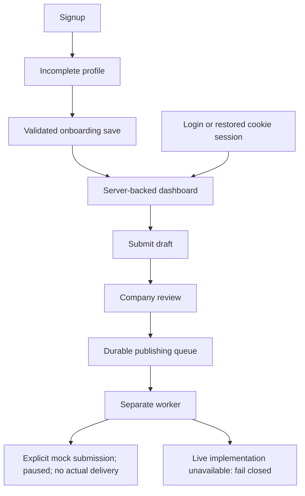

# PolitiAds — Master Project Status & AI Handoff Guide

> Read this guide before changing the project. Source code and scoped verification evidence take precedence over historical completion claims. A mock provider response is not actual publication, a captured customer payment is not earned revenue, and a successful build is not an end-to-end certification.

- **Last reviewed:** 27 October 2026.
- **Current stage:** Local application fixes verified on SQLite; production/provider activation remains blocked by the items below.
- **Verified environment:** Windows, Python 3.14, Node 24.13.1. A new backend virtual environment installed the dependency lock and passed the maintained 33-test suite.
- **Evidence:** `docs/verification-report.md`, `docs/ad-review-and-payments.md`, `backend/run_tests.py`, `scratch/test_review_browser.py`.

## 1. Product direction and fixed design rules

PolitiAds supports candidate profiles, draft submission and company review. Local/state election roles remain the intended product context. Approximately two-minute draft preparation is a target, not a measured result or publication promise.

- Keep candidate screens light and Buffer-inspired: clean spacing/grid, rounded controls and consistent typography.
- Keep the admin hub a dark cockpit.
- Keep interface labels in English; user-entered names/slogans can retain their language.
- Daily budget belongs in Create Ad, not onboarding.
- Proposed Chess/competitor/AI/scheduling capabilities are not implemented external services. Presentation must not claim a live feed or confirmed provider capability.

## 2. Status definitions

| Label | Meaning |
| --- | --- |
| डेमो तैयार / Demo ready | Local simulated behavior exists. |
| Backend तैयार / Backend ready | API/data path exists, with limits stated alongside it. |
| Integration बाकी / Integration pending | Connection, activation or provider acceptance is incomplete. |
| सत्यापित / Verified | Only the named check passed in the stated environment. |
| Blocked / Not verified | Dependencies unavailable or check not executed. |

## 3. Current status

| Area | Current state | Evidence and limit |
| --- | --- | --- |
| Password/session/RBAC | Verified locally | Argon2id, hashed sessions, HttpOnly cookies, role/owner checks, expiry/logout, suspension, CSRF/origin checks and per-client throttling. Production proxy/edge behavior still needs deployment review. |
| Database | Verified on SQLite | Real migrations, schema comparison and copy-first legacy upgrade. Existing development table row counts preserved; zero FK violations. PostgreSQL not tested. |
| Signup/onboarding | Verified main browser flow | Signup starts incomplete/not connected; validated profile save completes onboarding. Refresh restores the workspace. Provider authorization is separate. |
| Candidate dashboard/campaigns | Verified main browser flow | Server-loaded records and working handlers replace previously missing props. Draft submit uses CSRF/proxy; campaign submission details are snapshotted. Mock telemetry is not displayed as real reach/spend. |
| Admin review | Verified locally | Individual content editing, save/changes/reject/approve, immutable revision history, candidate consent, verified fund reservations and version-bound queue. Browser workflow passed with simulated provider; actual publication unavailable. |
| Publishing | Demo ready; real integration blocked | Persistent job stages, conditional claims, explicit deterministic mock recovery, kill-switch. Live writes/status controls fail closed. |
| Payments | Backend ready; provider acceptance pending | Actual Razorpay HTTP adapters implemented and contract-tested with MockTransport. Capture requires matching order/amount/currency/status. No real provider payment/refund/settlement executed. |
| Webhooks | Verified locally | Raw-body HMAC, header event ID, durable failed receipt, duplicate/concurrent protection and authenticated explicit replay. |
| Refunds | Verified locally | Atomic cumulative reservation, stable operation IDs, pending timeout handling, verified completion/reversal. Real provider reconciliation still required for ambiguous outcomes. |
| Accounting | Verified new-entry integrity | Paired debit/credit journal lines and append-only ORM accounting records. Deposits are customer credit, not fee revenue or actual Meta spend. Historical rows preserved without inventing journal evidence. |
| Uploads | Verified server paths | Type/content/byte/dimension checks cover uploads and inline profile/campaign payloads; images re-encoded. Storage remains validated data URLs, not a CDN/object store. |
| Plans/commission | Verified local pricing | Percentage/fixed-Meta allocation, prospective settings, immutable campaign pricing and consent for campaign overrides. Actual spend and earned fees are not recognized from deposits. |
| Billing screen | API connected | Reads user payment history with loading/error/empty behavior; no invented active subscription. Activated hosted checkout remains pending. |
| GPS/mobile/accessibility | Partially verified | Location picker exists; 390px dashboard width checked. Real GPS permission scenarios, other devices and exhaustive keyboard accessibility not executed. |
| Polls/service inquiries | Backend ready; scoped tests passed | Owner-scoped persistent service_records. Storage is not actual field-service fulfillment or messaging delivery. |
| Facebook login / Page and Instagram connections | Implemented; locally verified; provider acceptance unverified | Authorization code flow, app-scoped identity mapping, separate owned-Page and Instagram selection, full local disconnect, signed deauthorization. 27 OAuth tests and 8 local-simulator UI checks passed. Existing provider credentials retained; Meta Dashboard permissions/callback and real consent must still be verified. |
| Impersonation | Unavailable | Dossier access/notice only; no false session switching claim. |
| WhatsApp automation | Excluded | No political Business Platform bot/broadcast. In-app notifications are polled. |
| Setup | Verified backend lock installation | Explicit migrations/seeding/admin creation, environment examples and README. No automatic startup demo accounts. |

## 4. Current flow



Payment capture and company approval are independent. A provider publishing ID alone does not establish delivery. Pause/resume is not simulated as a successful real provider operation.

## 5. Verification and issue disposition

- 33 maintained backend regression tests passed, including a fresh isolated virtual environment run.
- 11 headless browser checks passed, including admin approval/queue, worker mock/paused results and failed/successful logout. See the verification report for the full list.
- Historical source lint passed without warnings. Current unrelated billing/landing/admin modules report seven warnings; production frontend bundle compiles. OAuth implementation itself has no source lint warning.
- Fresh Alembic upgrade/model comparison passed. Current development revision: `8051cdb33264`.
- Development upgrade created backups in `backend/data/backups/`, trialed a copy first, preserved row counts and passed foreign-key checks.

Old 35/11/10-check scripts contained obsolete Live/mock assumptions and incomplete failure coverage. Original scripts are archived in `docs/archived-tests/`; their old command names delegate to the maintained suite. Do not add these aliases together as independent passing tests or call this an external penetration-test certification.

| Previous finding | Disposition |
| --- | --- |
| AUTH-01/02 and DATA-01 | Core controls implemented; production configuration/operational review remains required. |
| REVIEW-01/02/03 | Schema mismatch and partial queue mutation fixed; review/job queue atomic; local Live bypass removed. Real delivery controls unavailable. |
| VALIDATION-01 | Campaign constraints and server upload/inline-image validation implemented and tested. |
| STORAGE-01 | SQLite migrations/upgrade verified; PostgreSQL unverified. |
| INTEGRATION-01 | Main candidate flow and admin API wiring implemented; some provider/service UI operations intentionally unavailable. |
| UI-01 | No undefined impersonation setter; real delegation is unavailable rather than falsely claimed. |
| UI-02 / MAINT-01 | Modular components and main controls present; source lint clean. Full UI/accessibility matrix remains open. |
| PROVIDER-01 | Mock/live boundaries corrected. Actual Meta publishing remains blocked; Razorpay provider acceptance and checkout pending. |
| SETUP-01 | Environment examples, direct dependencies, tested dependency lock and setup/operations instructions supplied. |

## 6. Remaining blockers

1. Actual Meta eligibility/authorization, account ownership, current API/permissions, live publishing/status implementation and real provider tests.
2. Actual merchant onboarding, provider test credentials, hosted checkout, payment/refund acceptance and settlement reconciliation.
3. Fee recognition, service fulfillment, subscription entitlements and historical accounting reconciliation rules.
4. PostgreSQL and production infrastructure/security/monitoring verification.
5. Full device/accessibility/GPS-permission matrix and complete admin tab verification.
6. Object storage/CDN media references if required for production.
7. Live ambiguous-job/refund recovery procedures verified against actual provider records.

No external payment, refund, political ad publication or message was sent during this fix. WhatsApp automation remains excluded; see the dated provider requirements document. Historical policy/version labels do not prove current provider acceptance.

## 7. Run and verify

Use root `README.md` for full PowerShell setup. Common commands from the project root:

```powershell
python -m alembic upgrade head
# Development only, explicitly requested local demo fixtures:
python backend/seed.py
python -m uvicorn main:app --app-dir backend --host 127.0.0.1 --port 8000
# Separate terminals:
python backend/worker.py
npm run dev
```

```powershell
npm run lint
npm run build
python -m unittest discover -s backend -p test_regressions.py -v
python scratch/test_browser_regressions.py
python -m alembic check
```

Existing databases must use the documented backup/trial-copy workflow rather than blind stamping. Backend `.env` loads explicitly; relative SQLite paths resolve from backend/. Dependency lock targets the tested Windows/Python environment.

## 8. File map

- `src/App.jsx`: session-aware composition and candidate API handlers.
- `src/api/`, `src/context/`: credentialed API/CSRF and session state.
- `src/features/`, `src/components/`: screens and shared UI.
- `backend/entities.py`, `database.py`, `migrations/`, root `alembic.ini`: persistence.
- `backend/security*.py`, `dependencies.py`: passwords/sessions, encryption, request guards.
- `backend/routers/`: authenticated domain endpoints and signed public webhook endpoint.
- `backend/services/`, `worker.py`: financial transactions and queued mock publishing.
- `backend/manage_db.py`, `create_admin.py`, `seed.py`: explicit management commands.
- `backend/test_regressions.py`, `scratch/test_browser_regressions.py`: maintained verification.
- `docs/verification-report.md`, `known-limitations.md`, `operations.md`, `integrations/`: evidence and blockers.

## 9. Strict user protocols

- **Approval Rule:** **"execution plan do, bina mere approval ke apply mat karna"**. Present a concrete execution plan and receive explicit approval before writing/modifying files. Approval applies to agreed scope; do not infer deployment, live spending or external messaging approval from local implementation approval.
- **Design Rule:** Buffer-inspired light candidate screens, dark admin cockpit, English interface labels. Preserve user-authored content language.
- **Budget Rule:** Daily budget belongs in Create Ad, never onboarding.
- **Status Rule:** Keep demo, actual integration, blocked dependencies and verified outcomes separate. Mark resolved only with scoped evidence; do not reintroduce blanket completion claims.


## Facebook/Instagram OAuth update — 27 October 2026

- The user explicitly requested localhost configuration for now. Callback: `http://localhost:5173/api/meta/oauth/callback`.
- `backend/.env` gained OAuth enablement/version/callback/configuration settings; existing App ID/App Secret were preserved and never printed.
- Manual token connect is removed (HTTP 410), social login no longer signs into a demo account, Page lists use the matching available_pages contract, and empty lookups cannot authorize manual Page IDs.
- Facebook identity login and business asset grants are separate. Page/Instagram status reflects verification; token grant alone does not establish selection or publication.
- Local disconnect clears metadata/tokens, cancels queued work and invalidates in-progress authorization. Instagram-only disconnect leaves Facebook connected. Signed provider deauthorization is verified/replay-protected; local disconnect remains available when kill-switch is enabled.
- Removed newly introduced category-NONE and nationwide-targeting retries from the legacy provider client. Removed its fallback to the global environment access token. Live publishing remains blocked in the worker.
- Both backend suites pass (33 + 27); OAuth browser simulator reports 8 passing checks. Actual provider user consent/approvals and production activation were not performed.
- Setup and remaining manual requirements: `docs/integrations/facebook-instagram-setup.md`.

## Approved review/pricing package — 27 October 2026

User explicitly approved the implementation plan. Added candidate draft/edit/resubmit, per-ad admin content review and separate save/changes/reject/approve actions, immutable revision history, prospective percentage/fixed-Meta pricing and campaign overrides requiring candidate acceptance, verified-credit reservations, version-bound jobs, shared provider checkout, bounded refund controls and payment receipts. No new poster upload or AI poster controls were added. Public admin quick-login and exposed credentials were removed. Known demo admin passwords are disabled; personal credentials must be provisioned locally with create_admin.py.

Migration head: `697c642caf16`; copy-first upgrade and backup completed with historical table row counts unchanged and zero FK violations. Maintained suites: 33 core + 27 OAuth + 13 review tests passed. Build and lint pass with zero warnings. Local browser checks use isolated databases and simulated providers. See `docs/ad-review-and-payments.md` and `scratch/test_review_browser.py`.

Do not claim actual Meta publication or live amendments, provider checkout acceptance, actual Meta expense, earned service fees, settlement or production readiness. Reserve currently covers one daily total; rolling spend/fee recognition remains unavailable. Submitted/processing provider jobs require confirmed provider pause/cancellation before edits; that live capability is not implemented. This update does not change the approval rule in section 8.

## Approved system design corrections — 27 October 2026

The user approved the four-package implementation plan. Added independent purchased subscription records with order-time plan snapshots, expiry/full-refund revocation, explicit immediate-replacement renewal and individual/aggregate daily cap enforcement. Approved jobs now freeze coordinates, Page/Instagram identity, connection generation, disclaimer, content/media, pricing and billing schedule. Added daily reservation/final-report settlement ports with proportional earned fees, consumed-credit refund protection and safe unknown/overspend states. Publishing uses leases/heartbeats, bounded attempts and reconciliation for expired live claims. Admin queue and history are paginated; historical media loads separately on demand.

Schema head: `48ab8d5a2bd0` after `b04322338644`. Both upgrades used copy-first validation and backups. Historical row counts preserved, zero FK violations. Verification: 33 core + 27 OAuth + 13 review + 24 system-design tests (97 total), eleven browser check groups with local fake providers, clean build/lint and Alembic schema comparison.

See `docs/system-design-fixes.md` for exact business rules and boundaries. Earlier one-day-only/no-lease/subscription limitations are superseded by this local implementation. Actual provider report retrieval, delivery pause/resume, cash settlement, production scheduling/activation, PostgreSQL and load certification remain unavailable or unverified. The internal confirmation type is not itself real provider evidence; a trusted adapter must verify it before settlement. Live publishing remains blocked. No new poster/AI controls were introduced. The existing approval rule remains in effect.
